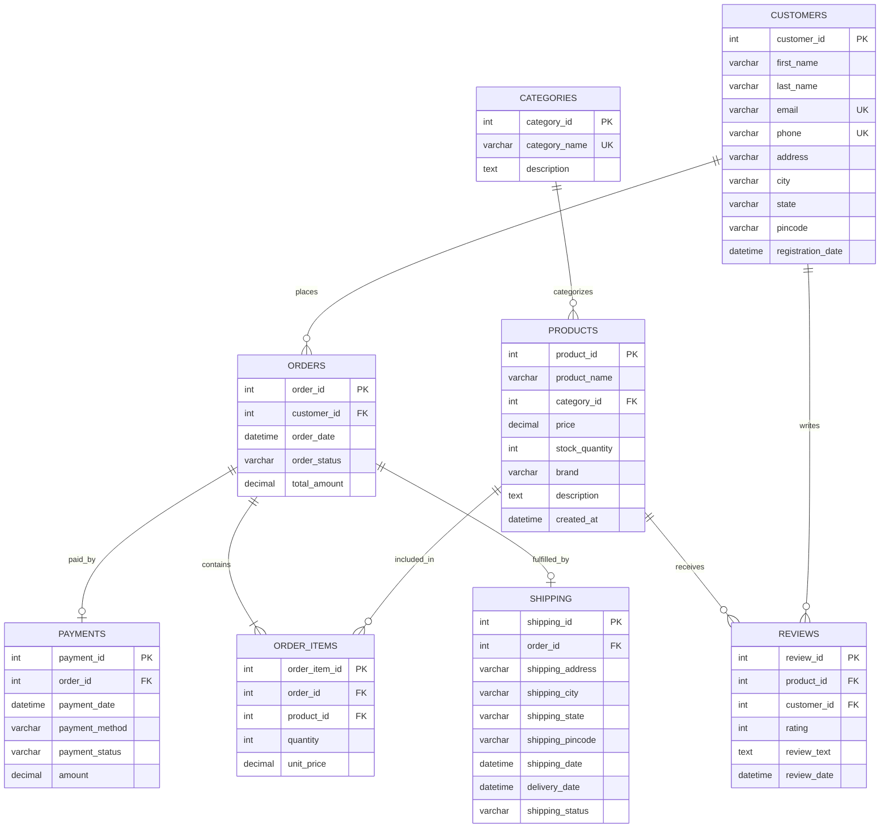

# E-Commerce Database Management System

> A relational SQL database system designed to manage customers, products, categories, orders, order items, payments, shipping, and other core e-commerce operations.

---

## 📌 Table of Contents
- [Overview](#overview)
- [Objectives](#objectives)
- [Features](#features)
- [Database Schema](#database-schema)
- [Entity Relationships](#entity-relationships)
- [Technologies Used](#technologies-used)
- [Project Structure](#project-structure)
- [Database Setup & Execution](#database-setup--execution)
- [Sample Queries & Outputs](#sample-queries--outputs)
- [SQL Concepts Demonstrated](#sql-concepts-demonstrated)
- [Business Analysis](#business-analysis)
- [Git Configuration & Commands](#git-configuration--commands)
- [Author](#author)

---

## Overview
The **E-Commerce Database Management System** is a normalized, relational database solution built in **MySQL 8.0+**. It is designed to model core online retail workflows including customer onboarding, category cataloging, product inventory management, checkout transactions, multi-method payment verification, order fulfillment, parcel tracking, and product reviews.

---

## Objectives
1. **Relational Integrity**: Enforce strict data consistency using Primary Keys, Foreign Keys, `UNIQUE`, `CHECK`, and `NOT NULL` constraints.
2. **Business Intelligence**: Provide actionable analytical queries for revenue tracking, best-selling inventory, customer retention, and logistics SLA monitoring.
3. **Query Optimization**: Implement targeted B-Tree indexes on foreign keys and frequently filtered columns to maintain optimal query performance.
4. **Academic & Professional Excellence**: Deliver clean, modular, and well-commented SQL scripts suitable for academic evaluation and GitHub portfolios.

---

## Features
- **Comprehensive Data Modeling**: 8 interconnected relational tables covering all aspects of e-commerce operations.
- **Realistic Dataset**: Indian e-commerce data featuring 18 customers across major tech hubs, 10 categories, 35 branded products, 30 orders, 60 order line items, payments, shipping logs, and customer reviews.
- **Advanced Joins Demonstration**: Complete implementations of `INNER`, `LEFT`, `RIGHT`, MySQL-compatible `FULL OUTER JOIN`, `SELF`, `CROSS`, `EQUI`, and `NATURAL` joins.
- **Analytical Intelligence**: 20 real-world analytical queries covering top spenders, dead stock, revenue contributions, delivery SLA times, and repeat buyer rates.
- **Database Views**: 5 pre-aggregated views for automated reporting dashboards.

---

## Database Schema



Detailed table definitions, column types, and constraints can be reviewed in [docs/database_schema.md](docs/database_schema.md).

---

## Entity Relationships
- **Customers → Orders**: One-to-Many (`1:N`). A customer can place multiple orders (`ON DELETE RESTRICT` preserves financial audit history).
- **Categories → Products**: One-to-Many (`1:N`). A category groups multiple products.
- **Orders → Order_Items**: One-to-Many (`1:N`). An order contains multiple line items (`ON DELETE CASCADE` removes order items if an order is cancelled/deleted).
- **Products → Order_Items**: One-to-Many (`1:N`). Products are linked across line items (`ON DELETE RESTRICT` protects catalog sales history).
- **Orders → Payments**: One-to-One / One-to-Many (`1:1` or `1:N`). Captures payment transaction records per order.
- **Orders → Shipping**: One-to-One (`1:1`). Tracks logistics, fulfillment, and delivery per order.
- **Products & Customers → Reviews**: Many-to-Many (`M:N`). Customers can write ratings and reviews for purchased products.

---

## Technologies Used
- **MySQL 8.0+** (Relational Database Management System)
- **SQL** (DDL, DML, DQL, Constraints, Joins, Subqueries, Views, Indexes)
- **Git** (Version Control System)
- **GitHub** (Remote Project Repository & Code Hosting)

---

## Project Structure

```text
E-Commerce-Database-Management-System/
│
├── .gitignore
├── README.md
│
├── database/
│   ├── 01_create_database.sql
│   ├── 02_create_tables.sql
│   ├── 03_constraints.sql
│   ├── 04_insert_data.sql
│   ├── 05_basic_queries.sql
│   ├── 06_update_delete.sql
│   ├── 07_aggregate_functions.sql
│   ├── 08_date_time_functions.sql
│   ├── 09_string_functions.sql
│   ├── 10_joins.sql
│   ├── 11_subqueries.sql
│   ├── 12_views.sql
│   ├── 13_indexes.sql
│   └── 14_final_analysis_queries.sql
│
├── docs/
│   ├── database_schema.md
│   └── queries_explanation.md
│
└── screenshots/
    └── .gitkeep
```

---

## Database Setup & Execution

Execute the SQL scripts in numerical order to maintain foreign key dependency order:

```text
01_create_database.sql
        ↓
02_create_tables.sql
        ↓
03_constraints.sql
        ↓
04_insert_data.sql
        ↓
05_basic_queries.sql
        ↓
06_update_delete.sql
        ↓
07_aggregate_functions.sql
        ↓
08_date_time_functions.sql
        ↓
09_string_functions.sql
        ↓
10_joins.sql
        ↓
11_subqueries.sql
        ↓
12_views.sql
        ↓
13_indexes.sql
        ↓
14_final_analysis_queries.sql
```

### Option A: Command Line / Terminal (Recommended)

Run the following commands in order from the project root:

```bash
# 1. Initialize database
mysql -u root -p < database/01_create_database.sql

# 2. Create tables
mysql -u root -p < database/02_create_tables.sql

# 3. Apply constraints
mysql -u root -p < database/03_constraints.sql

# 4. Insert sample data
mysql -u root -p < database/04_insert_data.sql

# 5. Run queries as needed:
mysql -u root -p < database/05_basic_queries.sql
mysql -u root -p < database/10_joins.sql
mysql -u root -p < database/12_views.sql
mysql -u root -p < database/13_indexes.sql
mysql -u root -p < database/14_final_analysis_queries.sql
```

### Option B: MySQL Workbench or VS Code (SQL Extension)
1. Open MySQL Workbench or VS Code.
2. Connect to your local MySQL instance.
3. Open `database/01_create_database.sql` through `14_final_analysis_queries.sql` in sequence and click **Execute (Ctrl+Shift+Enter)**.

---

## Sample Queries & Outputs

### 1. Best-Selling Products by Revenue
```sql
SELECT 
    p.product_id,
    p.product_name,
    p.brand,
    SUM(oi.quantity) AS total_units_sold,
    SUM(oi.quantity * oi.unit_price) AS total_revenue
FROM Products p
JOIN Order_Items oi ON p.product_id = oi.product_id
JOIN Orders o ON oi.order_id = o.order_id
WHERE o.order_status != 'Cancelled'
GROUP BY p.product_id, p.product_name, p.brand
ORDER BY total_revenue DESC
LIMIT 5;
```

### 2. Full Outer Join Equivalent (Customers and Orders)
```sql
SELECT 
    c.customer_id,
    CONCAT(c.first_name, ' ', c.last_name) AS customer_name,
    c.city,
    o.order_id,
    o.total_amount
FROM Customers c
LEFT JOIN Orders o ON c.customer_id = o.customer_id

UNION

SELECT 
    c.customer_id,
    CONCAT(c.first_name, ' ', c.last_name) AS customer_name,
    c.city,
    o.order_id,
    o.total_amount
FROM Customers c
RIGHT JOIN Orders o ON c.customer_id = o.customer_id;
```

### 3. Customer Lifetime Value View
```sql
SELECT * 
FROM customer_order_summary 
ORDER BY total_lifetime_spent DESC 
LIMIT 5;
```

---

## SQL Concepts Demonstrated
- **Data Definition Language (DDL)**: `CREATE DATABASE`, `CREATE TABLE`, `ALTER TABLE`, `DROP TABLE`, `CREATE VIEW`, `CREATE INDEX`.
- **Data Manipulation Language (DML)**: `INSERT INTO`, `UPDATE ... SET`, `DELETE FROM`, cascading deletes.
- **Data Query Language (DQL)**: `SELECT`, `WHERE`, `ORDER BY`, `DISTINCT`, `LIMIT`, `OFFSET`, `BETWEEN`, `IN`, `LIKE`, `IS NULL`.
- **Data Constraints**: `PRIMARY KEY`, `FOREIGN KEY`, `NOT NULL`, `UNIQUE`, `CHECK`, `DEFAULT`.
- **Aggregate Functions**: `COUNT()`, `SUM()`, `AVG()`, `MIN()`, `MAX()`.
- **Grouping & Filtering**: `GROUP BY`, `HAVING`.
- **SQL Joins**: `INNER JOIN`, `LEFT JOIN`, `RIGHT JOIN`, `FULL OUTER JOIN` (via `UNION`), `SELF JOIN`, `CROSS JOIN`, `EQUI JOIN`, `NATURAL JOIN`.
- **Subqueries**: Scalar single-row, multi-row (`IN`, `> ALL`), correlated subqueries (`EXISTS`, `NOT EXISTS`), and derived tables.
- **Built-in Functions**:
  - *Date/Time*: `CURDATE()`, `NOW()`, `YEAR()`, `MONTH()`, `DAY()`, `DATEDIFF()`, `DATE_FORMAT()`, `DATE_ADD()`.
  - *String*: `CONCAT()`, `CONCAT_WS()`, `UPPER()`, `LOWER()`, `LENGTH()`, `CHAR_LENGTH()`, `SUBSTRING()`, `TRIM()`, `REPLACE()`, `LPAD()`.
- **Performance Optimization**: B-Tree single and composite indexes.

---

## Business Analysis
The project answers 20 critical business intelligence questions, including:
1. **Catalog Performance**: Identifies dead stock vs fast-moving inventory items.
2. **Customer Segmentation**: Segments VIP buyers, repeat customers, and dormant registrations.
3. **Logistics Performance**: Tracks delivery turnaround SLAs and in-transit parcels across cities.
4. **Financial Health**: Evaluates payment gateway preferences, gross merchandise value, and category-level profit contributions.

See [docs/queries_explanation.md](docs/queries_explanation.md) for full descriptions of all analytical queries.

---

## Git Configuration & Commands

### Initializing and Publishing to GitHub

```bash
# 1. Navigate to the project root directory
cd E-Commerce-Database-Management-System

# 2. Initialize git repository
git init

# 3. Stage all project files
git add .

# 4. Create initial commit
git commit -m "Initial e-commerce database project"

# 5. Rename branch to main
git branch -M main

# 6. Link to your GitHub repository
git remote add origin YOUR_GITHUB_REPOSITORY_URL

# 7. Push project to GitHub
git push -u origin main
```

### Pushing Future Updates

```bash
git add .
git commit -m "Update SQL queries and documentation"
git push
```

---

## Author

- **Name**: YOUR NAME
- **Roll No**: YOUR ROLL NUMBER
- **College**: YOUR COLLEGE
- **Degree / Branch**: B.Tech / B.E. / BCA / MCA in Computer Science & Engineering
- **Subject**: Database Management Systems (DBMS) Laboratory / Project
