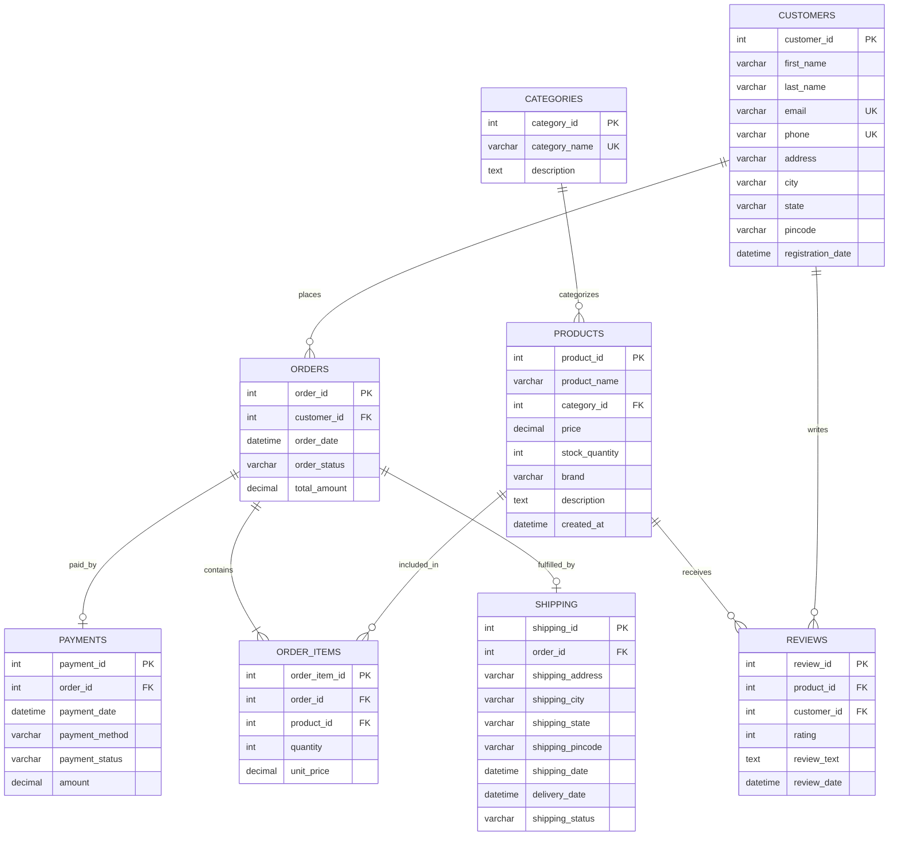

# Database Schema Documentation

## E-Commerce Database Management System

### System Overview
The **E-Commerce Database Management System** is a normalized relational database designed in **MySQL 8.0+** to model, track, and optimize transactions, inventory, logistics, customer accounts, payments, and feedback in a scalable online retail platform.

---

## 1. Entity-Relationship (ER) Diagram

---

## 2. Table Specifications & Data Dictionary

### Table 1: `Customers`
Stores registered customer accounts and regional billing/shipping addresses.

| Column Name | Data Type | Constraints | Description |
|:---|:---|:---|:---|
| `customer_id` | `INT` | `PRIMARY KEY`, `AUTO_INCREMENT` | Unique identifier for each customer |
| `first_name` | `VARCHAR(50)` | `NOT NULL` | Customer's first name |
| `last_name` | `VARCHAR(50)` | `NOT NULL` | Customer's last name / surname |
| `email` | `VARCHAR(100)` | `NOT NULL`, `UNIQUE` | Unique contact email address |
| `phone` | `VARCHAR(20)` | `NOT NULL`, `UNIQUE` | Validated contact phone number |
| `address` | `VARCHAR(255)` | `NOT NULL` | Residential street / apartment address |
| `city` | `VARCHAR(50)` | `NOT NULL` | City name (e.g., Hyderabad, Mumbai) |
| `state` | `VARCHAR(50)` | `NOT NULL` | State or administrative region |
| `pincode` | `VARCHAR(10)` | `NOT NULL` | Postal code |
| `registration_date` | `DATETIME` | `DEFAULT CURRENT_TIMESTAMP` | Account creation timestamp |

---

### Table 2: `Categories`
Classifies catalog products into distinct commercial segments.

| Column Name | Data Type | Constraints | Description |
|:---|:---|:---|:---|
| `category_id` | `INT` | `PRIMARY KEY`, `AUTO_INCREMENT` | Unique identifier for category |
| `category_name` | `VARCHAR(100)` | `NOT NULL`, `UNIQUE` | Human-readable category title |
| `description` | `TEXT` | `NULL` | Detailed scope of the category |

---

### Table 3: `Products`
Maintains product information, pricing, brand details, and warehouse stock.

| Column Name | Data Type | Constraints | Description |
|:---|:---|:---|:---|
| `product_id` | `INT` | `PRIMARY KEY`, `AUTO_INCREMENT` | Unique product identifier |
| `product_name` | `VARCHAR(150)` | `NOT NULL` | Official commercial product name |
| `category_id` | `INT` | `NOT NULL`, `FK -> Categories(category_id)` | Foreign key to Categories |
| `price` | `DECIMAL(10,2)` | `NOT NULL`, `CHECK (price > 0)` | Product unit price in INR |
| `stock_quantity` | `INT` | `NOT NULL`, `DEFAULT 0`, `CHECK (stock_quantity >= 0)` | Available physical stock units |
| `brand` | `VARCHAR(100)` | `NOT NULL` | Brand / manufacturer |
| `description` | `TEXT` | `NULL` | Product technical specs & summary |
| `created_at` | `DATETIME` | `DEFAULT CURRENT_TIMESTAMP` | Date product was added to catalog |

---

### Table 4: `Orders`
Captures purchase transactions placed by customers.

| Column Name | Data Type | Constraints | Description |
|:---|:---|:---|:---|
| `order_id` | `INT` | `PRIMARY KEY`, `AUTO_INCREMENT` | Unique order identifier |
| `customer_id` | `INT` | `NOT NULL`, `FK -> Customers(customer_id)` | Foreign key to Customers |
| `order_date` | `DATETIME` | `DEFAULT CURRENT_TIMESTAMP` | Transaction timestamp |
| `order_status` | `VARCHAR(30)` | `NOT NULL`, `DEFAULT 'Pending'`, `CHECK (order_status IN ('Pending','Processing','Shipped','Delivered','Cancelled'))` | Order lifecycle status |
| `total_amount` | `DECIMAL(10,2)` | `NOT NULL`, `DEFAULT 0.00`, `CHECK (total_amount >= 0)` | Total invoice value in INR |

---

### Table 5: `Order_Items`
Line-item junction table resolving the many-to-many relationship between Orders and Products.

| Column Name | Data Type | Constraints | Description |
|:---|:---|:---|:---|
| `order_item_id` | `INT` | `PRIMARY KEY`, `AUTO_INCREMENT` | Unique line item identifier |
| `order_id` | `INT` | `NOT NULL`, `FK -> Orders(order_id) ON DELETE CASCADE` | Associated order ID |
| `product_id` | `INT` | `NOT NULL`, `FK -> Products(product_id)` | Associated product ID |
| `quantity` | `INT` | `NOT NULL`, `DEFAULT 1`, `CHECK (quantity > 0)` | Number of units purchased |
| `unit_price` | `DECIMAL(10,2)` | `NOT NULL`, `CHECK (unit_price >= 0)` | Unit sale price snapshot at order time |

---

### Table 6: `Payments`
Stores financial transactions, gateway payment channels, and processing status.

| Column Name | Data Type | Constraints | Description |
|:---|:---|:---|:---|
| `payment_id` | `INT` | `PRIMARY KEY`, `AUTO_INCREMENT` | Unique payment record ID |
| `order_id` | `INT` | `NOT NULL`, `FK -> Orders(order_id) ON DELETE CASCADE` | Order tied to payment |
| `payment_date` | `DATETIME` | `DEFAULT CURRENT_TIMESTAMP` | Payment timestamp |
| `payment_method` | `VARCHAR(50)` | `NOT NULL`, `CHECK (payment_method IN ('UPI','Credit Card','Debit Card','Net Banking','Cash on Delivery'))` | Payment instrument used |
| `payment_status` | `VARCHAR(30)` | `NOT NULL`, `DEFAULT 'Pending'`, `CHECK (payment_status IN ('Pending','Completed','Failed','Refunded'))` | Settlement status |
| `amount` | `DECIMAL(10,2)` | `NOT NULL`, `CHECK (amount >= 0)` | Amount processed in INR |

---

### Table 7: `Shipping`
Tracks logistics fulfillment, shipping dispatch, transit addresses, and delivery dates.

| Column Name | Data Type | Constraints | Description |
|:---|:---|:---|:---|
| `shipping_id` | `INT` | `PRIMARY KEY`, `AUTO_INCREMENT` | Unique shipment tracking ID |
| `order_id` | `INT` | `NOT NULL`, `FK -> Orders(order_id) ON DELETE CASCADE` | Associated order |
| `shipping_address` | `VARCHAR(255)` | `NOT NULL` | Destination address |
| `shipping_city` | `VARCHAR(50)` | `NOT NULL` | Destination city |
| `shipping_state` | `VARCHAR(50)` | `NOT NULL` | Destination state |
| `shipping_pincode` | `VARCHAR(10)` | `NOT NULL` | Destination postal code |
| `shipping_date` | `DATETIME` | `NULL` | Dispatch date & time |
| `delivery_date` | `DATETIME` | `NULL` | Confirmed delivery timestamp |
| `shipping_status` | `VARCHAR(30)` | `NOT NULL`, `DEFAULT 'Processing'`, `CHECK (shipping_status IN ('Processing','Dispatched','In Transit','Out for Delivery','Delivered','Returned','Cancelled'))` | Logistics status |

---

### Table 8: `Reviews`
Enables verified customer feedback and star ratings on products.

| Column Name | Data Type | Constraints | Description |
|:---|:---|:---|:---|
| `review_id` | `INT` | `PRIMARY KEY`, `AUTO_INCREMENT` | Unique review identifier |
| `product_id` | `INT` | `NOT NULL`, `FK -> Products(product_id) ON DELETE CASCADE` | Product reviewed |
| `customer_id` | `INT` | `NOT NULL`, `FK -> Customers(customer_id) ON DELETE CASCADE` | Author customer |
| `rating` | `INT` | `NOT NULL`, `CHECK (rating BETWEEN 1 AND 5)` | Rating stars (1 to 5) |
| `review_text` | `TEXT` | `NULL` | Written review feedback |
| `review_date` | `DATETIME` | `DEFAULT CURRENT_TIMESTAMP` | Timestamp of submission |

---

## 3. Referential Integrity Rules Summary

1. **Customers to Orders**: `ON UPDATE CASCADE, ON DELETE RESTRICT`  
   *Prevents accidental deletion of customers who have order history, maintaining historical financial compliance.*
2. **Categories to Products**: `ON UPDATE CASCADE, ON DELETE RESTRICT`  
   *Prevents dropping a category while products are still assigned to it.*
3. **Orders to Order_Items / Payments / Shipping**: `ON UPDATE CASCADE, ON DELETE CASCADE`  
   *When a cancelled order is removed, all dependent transaction records are automatically cleaned up to prevent orphan rows.*
4. **Products to Order_Items**: `ON UPDATE CASCADE, ON DELETE RESTRICT`  
   *Protects audit history so products referenced in prior orders cannot be deleted.*
